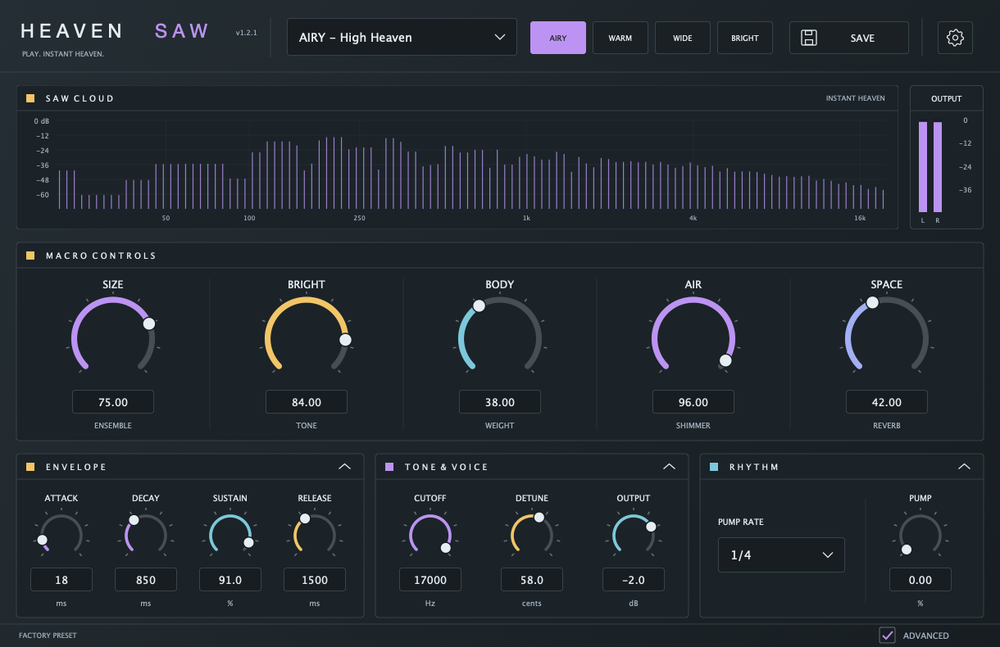

# Heaven Saw Synth

[English](README.md) · [简体中文](README.zh-CN.md)

**面向厚实、宽阔 saw 和弦的原生 Apple Silicon VST3 合成器。**

在 DAW 中弹奏完整和弦，用少量旋钮调整音色。当前版本为 **1.2.1**，采用 [AGPLv3](LICENSE) 许可。



## 下载

- [最新版本](https://github.com/RSK21X/heaven-saw-synth/releases/latest)
- [v1.2.1 发布页与下载](https://github.com/RSK21X/heaven-saw-synth/releases/tag/v1.2.1)

下载 `Heaven-Saw-Synth-v1.2.1-macOS-arm64-VST3.zip`，内含 `.vst3` 插件与安装说明。同一发布页附有源代码和 SHA-256 校验文件。

| 项目 | 当前发布版支持 |
| --- | --- |
| 系统 | macOS 12 或更新版本 |
| 处理器 | Apple Silicon，arm64 |
| 插件格式 | VST3 乐器 |
| 音频输出 | 立体声 |
| 输入 | DAW 发送的 MIDI 音符 |

下载版使用本机开发签名，尚未公证。目前没有 Intel Mac、Windows、Linux、AU 或 VST2 下载版。

## 安装

1. 退出 DAW，解压下载包。
2. 将 `Heaven Saw Synth.vst3` 复制到以下任一目录：
   - 所有用户：`/Library/Audio/Plug-Ins/VST3/`
   - 当前账户：`~/Library/Audio/Plug-Ins/VST3/`
3. 启动 DAW，必要时重新扫描 VST3。
4. 在 MIDI／乐器轨道加载 **Heaven Saw Synth**，确认左上角显示 **v1.2.1**。
5. 选择 **INIT - Heaven Saw** 或 **DROP - Festival Wall**，弹奏完整和弦。

更多中英文安装、更新和预设文件说明见 [INSTALL.md](INSTALL.md)。

## 控件

| 控件 | 作用 |
| --- | --- |
| SIZE | 合奏规模与立体声展开程度 |
| BRIGHT | 音色明亮度 |
| BODY | 中低频谐波的重量感 |
| AIR | 高八度声部带来的空气感 |
| SPACE | 混响量 |
| PUMP | DAW 播放期间的节奏压低效果 |

- **40 个工厂预设**，提供 AIRY、WARM、WIDE、BRIGHT 快捷按钮。
- **ENVELOPE：** Attack、Decay、Sustain、Release。
- **TONE & VOICE：** Cutoff、Detune、Output。
- **RHYTHM：** PUMP 深度与 1/2、1/4、1/8 分拍，或 OFF；跟随 DAW 的速度和播放位置。
- **SAVE** 导出 `.heavensaw` 个人预设。齿轮菜单支持载入预设、恢复初始音色，以及 80%、100%、120% 界面尺寸。
- 可直接编辑旋钮数值，双击恢复默认值。面板箭头可单独折叠；**ADVANCED** 显示或隐藏下方面板。
- 频谱与左右电平表显示插件的实际输出。

**v1.2.0 已删除 CHORD 模式。** 一个 MIDI 按键只触发一个音符。演奏和弦时，由 DAW 发送完整和弦的各个音符。旧项目保留其他音色设置，原 CHORD 设置将被忽略。

## 声音引擎

16 个复音声部组合中心 saw／square／triangle 层、宽立体声 saw 合奏层和独立高八度 saw 层。包含 detune 分布、按频段调整的立体声宽度、密度处理、chorus、带压低效果的混响、同步 PUMP，以及带前瞻的输出限幅。支持延音踏板、保持音踏板和弯音。

## 从源码构建

需要 macOS 12+、Apple Silicon、Xcode 命令行工具、CMake 3.22+、Git，以及首次配置时的网络访问。CMake 会获取 **JUCE 8.0.12**。

```sh
git clone https://github.com/RSK21X/heaven-saw-synth.git
cd heaven-saw-synth
cmake -S . -B build -DCMAKE_BUILD_TYPE=Release
cmake --build build --config Release --target HeavenSawSynth_VST3 -j4
```

生成的插件位于：

```text
build/HeavenSawSynth_artefacts/Release/VST3/Heaven Saw Synth.vst3
```

macOS 构建会在生成 VST3 描述文件之后，对完整开发版插件包签名并验证。

## 验证

v1.2.1 已通过 **24 项回归检查**与 **pluginval 1.0.4 严格度 8**。覆盖音频处理、MIDI 时序与音符释放、预设文件、项目状态恢复、音色控件、真实频谱与电平数据，以及三种界面尺寸、两种像素密度下的标题文字。

- 采样率：44.1、48、88.2、96 kHz。
- 缓冲区：32、64、128、256、512、1024 个采样。
- 前一版 1.2.0 的 9 组音频输出与 1.1.0 完全一致；1.2.1 修改标题字体间距和插件包签名流程。
- 已检查插件架构、签名、安装文件及下载包。

运行本地检查：

```sh
cmake -S . -B build -DCMAKE_BUILD_TYPE=Release -DHEAVEN_BUILD_AUDIO_SMOKE=ON
cmake --build build --config Release --target HeavenSawSmoke -j4
mkdir -p snapshots
./build/HeavenSawSmoke_artefacts/Release/HeavenSawSmoke "$(pwd)/snapshots"
```

记录见 [validation/](validation/)。独立 Steinberg 验证器不可用；这些检查不代表已经验证所有 DAW，也不代表听感与某首商业参考曲完全一致。

## 更新与依赖

详见 [CHANGELOG.md](CHANGELOG.md)、[FONT_UPDATE.md](FONT_UPDATE.md)、[UI_UPDATE.md](UI_UPDATE.md)、[SOUND_UPDATE.md](SOUND_UPDATE.md) 和 [REVIEW.md](REVIEW.md)。

JUCE 使用 AGPLv3 与商业许可证双重许可，其说明及 VST3 SDK 说明保留在 [THIRD_PARTY_NOTICES.md](THIRD_PARTY_NOTICES.md)。项目原有源代码采用 [AGPLv3，仅第 3 版](LICENSE) 许可，见 [NOTICE](NOTICE)。
